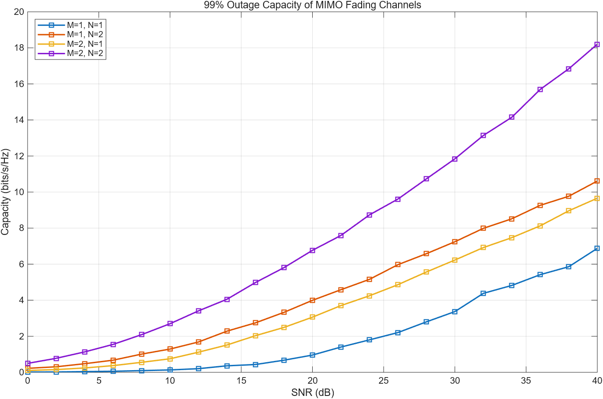
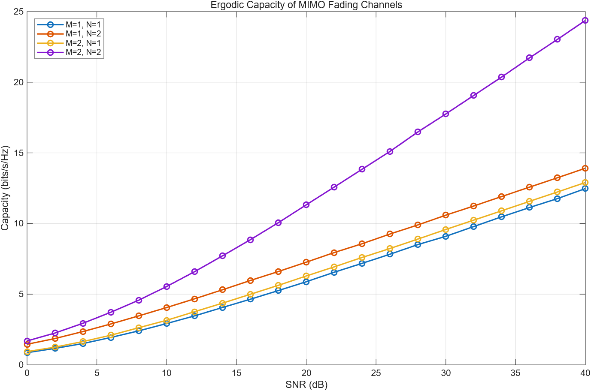

# Rayleigh MIMO 容量与中断性能仿真

用 MATLAB 蒙特卡洛仿真比较 1×1、1×2、2×1、2×2 天线配置的遍历容量和 1% 中断容量。

## 仿真设置

| 参数 | 取值 |
|---|---|
| 信道 | 独立同分布 Rayleigh 平坦衰落 |
| CSI 条件 | 接收端已知，发射端未知，等功率分配 |
| SNR 范围 | 0–40 dB，步长 2 dB |
| 每点信道数 | 10,000 |
| 随机种子 | `rng(1)`，结果可复现 |

每次信道实现的容量为：

```text
C = log2 det(I + (ρ / M) · H Hᴴ)
```

遍历容量取样本均值，1% 中断容量取样本的 1% 分位。

## 主要结果

单位是 bit/s/Hz：

| 配置 | 遍历容量，30 dB | 遍历容量，40 dB | 1% 中断容量，30 dB | 1% 中断容量，40 dB |
|---|---:|---:|---:|---:|
| 1×1 | 9.10 | 12.48 | 3.37 | 6.88 |
| 1×2 | 10.59 | 13.91 | 7.24 | 10.61 |
| 2×1 | 9.58 | 12.90 | 6.23 | 9.66 |
| 2×2 | 17.76 | 24.37 | 11.84 | 18.20 |

- **复用增益：** 从 30 dB 到 40 dB，2×2 的中断容量增加 6.36，1×2 增加 3.37，比值约 1.9，接近理论值 2。
- **阵列增益：** 1×2 比 2×1 高约 1 bit/s/Hz，对应发射端无 CSI 时功率分摊造成的 3 dB 差距。

完整数据见 [results/capacity_results.csv](results/capacity_results.csv)。





## 局限

- 容量是理论上限，这里没有仿真具体的编码、调制和检测算法。
- 1% 分位来自 10,000 个样本，低端只有约 100 个样本，曲线仍有随机波动。

## 运行方法

在 MATLAB 中运行，结果和图片会保存到 `results` 文件夹：

```matlab
mimo_capacity
```
